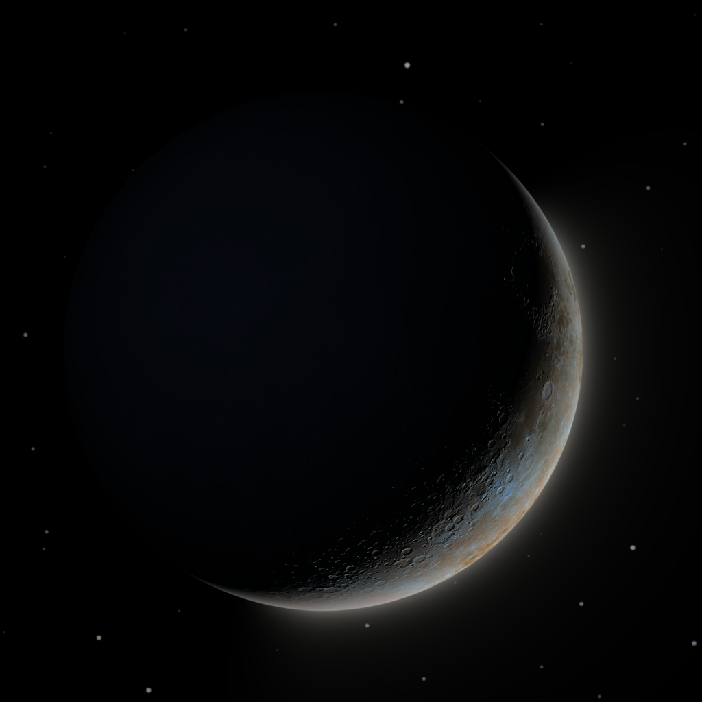
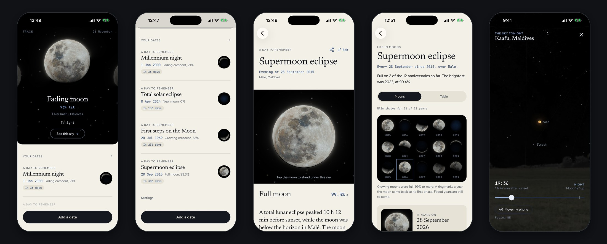
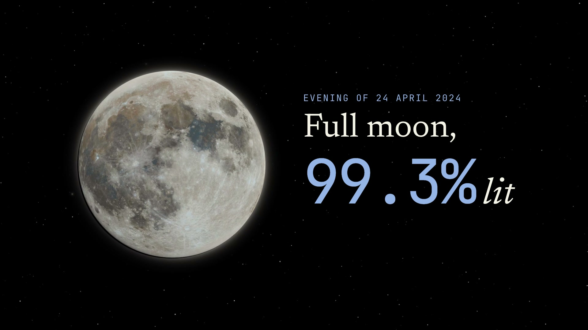

<p align="center"></p>

<h1 align="center">TRACE</h1>

<p align="center">Give it a date and a place. It shows the moon that was over that night, how rare that moon was, and the years it comes back.</p>

<p align="center">
  <a href="https://github.com/ukasha167/TRACE/actions/workflows/ci.yml"></a>
  <a href="https://github.com/ukasha167/TRACE/releases/latest"></a>
  <a href="LICENSE"></a>
</p>

<p align="center"></p>

<p align="center">
  
  
  
  
  
  
  
  
</p>

Offline-first, built with Expo, React Native and TypeScript. Every astronomical calculation and the planetarium run on the phone. There is no backend.

The screens above are from the iOS simulator. In the reveal, the app notices that the 2015 eclipse happened 10 hours before sunset in the Maldives, while the moon was below the horizon, and says so instead of claiming an eclipse you could have seen.

## Numbers

- **253 unit tests, all passing in 2.4 s** (`npm test`, run on 25 Nov 2026).
- **Sky maths checked against an independent library.** The app's own sky transform agrees with `astronomy-engine` to 23.6 arcseconds at worst, over 100 comparisons from 1990 to 2050 at 5 places (`docs/ASTRONOMY.md`).
- **Star projection: 0.70 ms a frame** with Hermes' interpreter as the stand-in (`node --jitless`), down from 1.38 ms after reordering the airmass step. With a JIT it is 0.135 ms. A 120 Hz frame has 8.3 ms.
- **A 120 Hz regression found and fixed on a Pixel 7 Pro.** Creating Skia shaders every frame made Hermes count about 4 MB of garbage per frame, and frames over the 8.33 ms deadline went from 12.5% to 70.8%. The fix caches the recorder and shaders and writes uniforms in place.
- **Moon tilt, measured.** An earlier approximation of the moon's tilt was up to 66° off near full moon against `astronomy-engine` over 2,000 samples. It now has a test that holds it within 1°.
- **Home with 10 records decoded 22 moon textures at 1024 px.** It now decodes one shared texture and 256 px thumbnails.

## Try it

- **Android:** install `TRACE-v1.0.0.apk` from the [latest release](https://github.com/ukasha167/TRACE/releases/latest).
- **iOS or Android, from source,** in Expo Go or a simulator:

  ```bash
  git clone https://github.com/ukasha167/TRACE.git && cd TRACE && npm install && npx expo start
  ```

- **The 25-second launch film:**

  [](https://github.com/ukasha167/TRACE/releases/download/v1.0.0/trace-launch.mp4)

---

## Features

- **The reveal.** Saving a date plays the moon of that night rising at its real phase and tilt, then four lines: when and where, how lit, one fact about the night, and how uncommon it was or when it comes back.
- **That night, in words.** When the moon rose and set against sunset and sunrise, how high it climbed and in which direction, the constellation it sat in, the planets up at midnight, and any lunar eclipse.
- **Moon returns.** The anniversaries, 60 years either side, when the moon comes back to within a day of the same phase, each named by its cycle (Metonic 19 years, 11, 8, and their sums), drawn on a timeline with today marked. Jupiter and Saturn returns sit beside them.
- **Measured rarity.** How many days in a 29,220-day window carry a moon at least as full as the threshold this one clears, and how many of the record's own anniversaries so far have.
- **Coming up and reminders.** The next anniversary, the moon it will bring, and an optional notification at 19:00 on the night.
- **Life in moons.** Every anniversary's moon in one grid, full ones glowing and return years ringed, each opening onto NASA's Astronomy Picture of the Day for that date.
- **The sky that night.** A star map on the record page, and a full-screen planetarium that follows the phone or a finger, scrubs from sunset to sunrise, draws the moon at its phase, shows a lunar eclipse's shadow, and names what you tap: 6,331 stars to magnitude 6.2, 25 constellations drawn with their figures, and the five planets you can see by eye.
- **Tonight.** Tonight's moon on Home, any other night's by a dial, the next full and new moon, moonrise and moonset, and the next 30 nights.
- **Share cards.** A night card or a paper card, 1080 by 1920 or 1080 by 1080, with an optional line of your own.
- **Backup and restore.** The records as one file through the share sheet, and back in without overwriting anything.
- **Privacy.** No accounts, no tracking, no ads. Records stay on the phone. A place you search for goes to the phone's geocoder (Apple or Google), and a record's date goes to NASA to fetch that day's picture.

---

## How it is built

### Stack

- **Framework**: [Expo](https://expo.dev) (~57) with [Expo Router](https://docs.expo.dev/router/introduction/) (file-based routing) and React Native (0.86). Fully compatible with Expo Go.
- **Rendering & Shaders**: [@shopify/react-native-skia](https://shopify.github.io/react-native-skia/) & [React Native Reanimated](https://docs.swmansion.com/react-native-reanimated/) for the celestial projection and the SkSL shader that lights the moon.
- **Astronomy**: Coordinate transforms in plain TypeScript, with [`astronomy-engine`](https://github.com/cosinekitty/astronomy) for planets, rise and set, eclipses and cross-checks, and [`suncalc`](https://github.com/mourner/suncalc) for the moon's phase and angles.
- **State Management**: [Zustand](https://github.com/pmndrs/zustand) with `@react-native-async-storage/async-storage` persistence.
- **Pictures**: NASA's Astronomy Picture of the Day, read from its archive pages for past dates and its API for recent ones, cached in AsyncStorage.
- **Reminders**: `expo-notifications`, local only.

### Project structure

```
src/
├── app/            # File-based routes (Expo Router)
├── components/     # UI components, Skia canvas renderers, and lunar shaders
├── hooks/          # Custom hooks (device orientation, sensors, animations)
├── lib/
│   ├── astronomy/  # Pure astronomical maths, where most of the tests point
│   ├── reminders/  # The reminder plan and its words
│   ├── backup/     # The records file, written and read
│   └── apod/       # NASA's pictures: API, archive pages, cache
├── store/          # Zustand store with persistence
└── data/           # Pre-compiled Yale star catalog, constellations, their star labels, the Milky Way's scale
```

---

## Getting started

### Prerequisites

- [Node.js](https://nodejs.org/) 20.19.4 or newer (22 or 24 recommended)
- [Expo Go](https://expo.dev/go) app on your mobile device, or an iOS Simulator / Android Emulator

### Installation

1. Clone the repository:
   ```bash
   git clone https://github.com/ukasha167/TRACE.git
   cd TRACE
   ```

2. Install dependencies:
   ```bash
   npm install
   ```

### Running the app

Start the Expo development server:

```bash
npx expo start
```

- Press **`i`** to launch in the iOS Simulator.
- Press **`a`** to launch in the Android Emulator.
- Scan the QR code with your camera (iOS) or the Expo Go app (Android) to test on a physical device.

### NASA API key (optional)

The app asks NASA's APOD API for the pictures of the last two weeks; older dates come from the archive pages and need no key. A fallback `DEMO_KEY` is built in, limited to 30 requests an hour.

For unrestricted use (1,000 requests/hour):
1. Obtain a free API key at [api.nasa.gov](https://api.nasa.gov).
2. Create a `.env` file in the project root:
   ```env
   EXPO_PUBLIC_NASA_API_KEY=your_api_key_here
   ```
3. Restart the Expo development server. Alternatively, you can paste your key in the in-app Settings screen.

---

## Development and testing

TRACE uses `tsx` with Node's built-in test runner for unit tests:

```bash
# Run the unit tests (253)
npm test

# Type check with TypeScript
npx tsc --noEmit
```

---

## Data and attribution

- **Stars (8,404 in the catalog to mag 6.5; the sky draws the 6,331 brighter than 6.2)**: Yale Bright Star Catalog (5th Revised Ed., Public Domain)
- **Proper Star Names (333)**: IAU Working Group on Star Names (IAU-CSN)
- **Constellation lines**: [d3-celestial](https://github.com/ofrohn/d3-celestial) (BSD-3-Clause)
- **Constellation Illustrations**: Johan Meuris for Stellarium (Free Art License 1.3)
- **Star colours (B-V)**: Yale Bright Star Catalog via VizieR V/50 (Public Domain)
- **Milky Way**: [Deep Star Maps 2020](https://svs.gsfc.nasa.gov/4851), Ernie Wright, NASA Scientific Visualization Studio (Public Domain)
- **Astronomy Picture of the Day**: NASA (Public Domain / respective authors)

---

## Contributing

Bug reports, fixes and ideas are welcome. Start with [CONTRIBUTING.md](CONTRIBUTING.md), pick up an issue labelled [good first issue](https://github.com/ukasha167/TRACE/labels/good%20first%20issue), or ask in [Discussions](https://github.com/ukasha167/TRACE/discussions).

---

## License

This project is licensed under the [MIT License](LICENSE).
